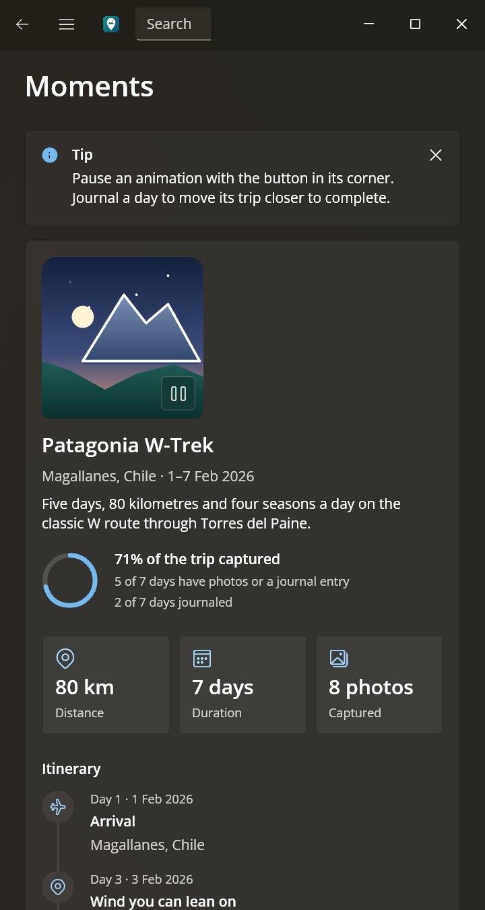
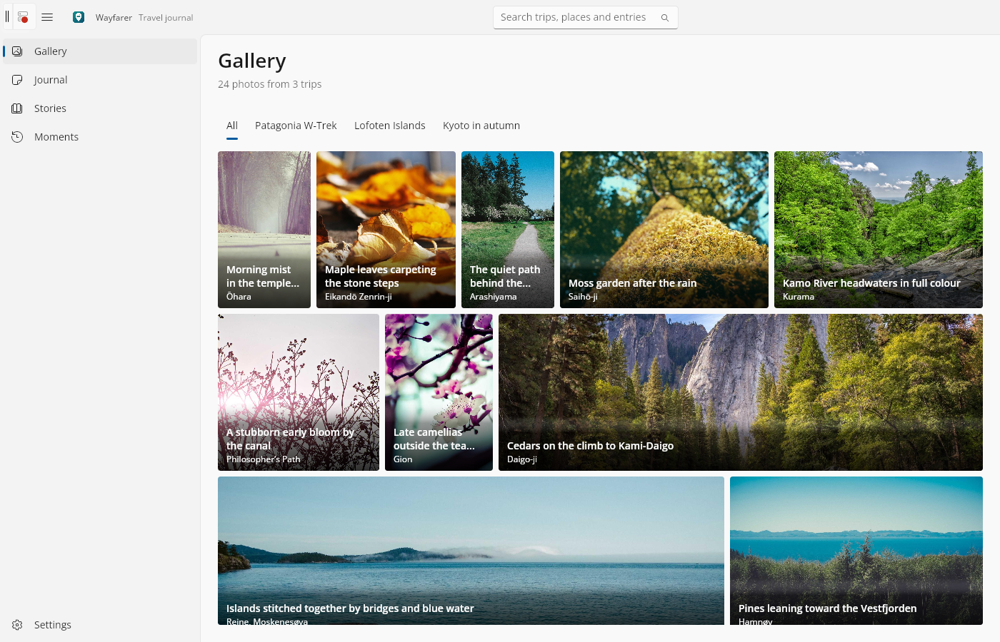

# Wayfarer

**A travel journal built with [Uno Platform](https://platform.uno) 7.0.** It's one C#/XAML codebase on the WinUI API, running on Windows, macOS, Linux, the web, Android, iOS and Apple TV.

Wayfarer keeps three trips (Lofoten, Kyoto and Patagonia) as a photo gallery, a rich-text journal, magazine-style stories and an animated trip dashboard. It's small enough to read in an afternoon, and every screen leans on something new in Uno Platform 7.0.

<p align="center">
  
  
</p>

## What Uno Platform 7.0 features this shows

| Feature | Where to see it | Where it lives |
| --- | --- | --- |
| **LinedFlowLayout** in an `ItemsView`, using `LineHeight`, `LineSpacing`, `ItemsJustification`, `ItemsStretch` and `ItemsInfoRequested` aspect ratios | Gallery | [`Views/GalleryPage.xaml`](Wayfarer/Views/GalleryPage.xaml), [`GalleryPage.xaml.cs`](Wayfarer/Views/GalleryPage.xaml.cs) |
| **RichEditBox** with bold, italic, underline, strikethrough, font colour, links, undo/redo, and RTF import/export through `Document.GetText`/`SetText` | Journal | [`Views/JournalEntryEditor.xaml`](Wayfarer/Views/JournalEntryEditor.xaml), [`JournalEntryEditor.xaml.cs`](Wayfarer/Views/JournalEntryEditor.xaml.cs), [`Helpers/RtfBuilder.cs`](Wayfarer/Helpers/RtfBuilder.cs) |
| **RichTextBlock** flowing through **RichTextBlockOverflow** columns, with an `InlineUIContainer` map pin, styled place names and hyperlinks | Stories | [`Views/StoriesPage.xaml`](Wayfarer/Views/StoriesPage.xaml), [`Helpers/StoryComposer.cs`](Wayfarer/Helpers/StoryComposer.cs) |
| **AnimatedVisualPlayer** playing Lottie JSON with no extra package or UnoFeature | Moments | [`Views/MomentCard.xaml`](Wayfarer/Views/MomentCard.xaml), [`Assets/Lottie`](Wayfarer/Assets/Lottie) |
| **ProgressRing** using WinUI's own animation, as a determinate ring with a track | Moments | [`Views/MomentCard.xaml`](Wayfarer/Views/MomentCard.xaml) |
| **TitleBar** with `ExtendsContentIntoTitleBar`/`SetTitleBar`, hosting search, back and the pane toggle | Every page | [`Views/MainPage.xaml`](Wayfarer/Views/MainPage.xaml), [`MainPage.xaml.cs`](Wayfarer/Views/MainPage.xaml.cs) |
| **Smooth scrolling** with native flings and smooth wheel scrolling in `ScrollViewer` and `ScrollView` | Gallery, Stories, Moments | No code needed |
| **Multi-window**: "Open in new window" gives each entry its own window, and on iPad each window is its own UIKit scene | Journal, ⋯ menu | [`Helpers/EntryWindow.cs`](Wayfarer/Helpers/EntryWindow.cs), [`Platforms/iOS/SceneDelegate.iOS.cs`](Wayfarer/Platforms/iOS/SceneDelegate.iOS.cs), [`Platforms/iOS/Info.plist`](Wayfarer/Platforms/iOS/Info.plist) |
| **tvOS** head (`net10.0-tvos`) with `XYFocusKeyboardNavigation="Enabled"` for the Siri Remote | The whole shell | [`Views/MainPage.xaml`](Wayfarer/Views/MainPage.xaml), [`Platforms/tvOS`](Wayfarer/Platforms/tvOS) |
| **Accessibility**: TalkBack and VoiceOver through automation peers, with names on icon-only controls and labelled value pairs | Everywhere, e.g. Settings › Rendering | `AutomationProperties` throughout [`Views`](Wayfarer/Views) |
| **Theme-aware WebAssembly splash** that follows the browser's light or dark theme | Web | `UnoSplashScreenBackgroundColor` / `UnoSplashScreenDarkBackgroundColor` in [`Wayfarer.csproj`](Wayfarer/Wayfarer.csproj) |
| **WebGPU** rendering backend (opt-in) | Any page | See [Opt into WebGPU](#opt-into-webgpu) |

It also follows WinUI's Fluent guidance throughout: type-ramp styles, `{ThemeResource}` brushes with Light, Dark and High Contrast support, a 4px spacing grid, and `x:Bind` with explicit modes.

## Screenshots

| | Light | Dark |
| --- | --- | --- |
| Gallery |  |  |
| Journal |  |  |
| Stories |  |  |
| Moments |  |  |
| Settings |  |  |

<p align="center">
  
  
  
</p>

<p align="center">
  <br />
  <em>The same app in the browser, on WebAssembly.</em>
</p>

## Run it

You need the [.NET 10 SDK](https://dotnet.microsoft.com/download). The Uno.Sdk version is pinned in [`global.json`](global.json) and restores on its own. Run `uno-check` from [Uno Platform's setup guide](https://platform.uno/docs/articles/get-started.html) to install the workloads for mobile and web.

| Target | Command | Notes |
| --- | --- | --- |
| **Desktop** (Windows, macOS, Linux) | `dotnet run --project Wayfarer -f net10.0-desktop` | Skia renderer, native window chrome |
| **Web** (WebAssembly) | `dotnet run --project Wayfarer -f net10.0-browserwasm` | Opens at http://localhost:5000 |
| **Android** | `dotnet build Wayfarer -f net10.0-android -t:Run` | With an emulator running or a device attached |
| **iOS / iPadOS** | `dotnet build Wayfarer -f net10.0-ios -t:Run` | On a Mac with Xcode. Use an iPad to try multi-window |
| **Apple TV** | `dotnet build Wayfarer -f net10.0-tvos -t:Run` | On a Mac with Xcode |
| **Windows** (WinAppSDK) | Open `Wayfarer.sln` in Visual Studio and run the *Wayfarer (WinAppSDK Packaged)* profile | Native WinUI 3, no Uno renderer |

Visual Studio, Rider and VS Code (with the Uno Platform extension) also pick up the launch profiles in [`Properties/launchSettings.json`](Wayfarer/Properties/launchSettings.json).

## Opt into WebGPU

Skia renders by default. To try the WebGPU backend:

1. Add `WebGpu` to the features in [`Wayfarer.csproj`](Wayfarer/Wayfarer.csproj). Skia stays in the app, and the runtime picks a backend when the host starts:

   ```xml
   <UnoFeatures>
     Mvvm;
     SkiaRenderer;
     WebGpu;
   </UnoFeatures>
   ```

2. Register the backend on the host builder in the head's `Program.cs` (for example [`Platforms/Desktop/Program.cs`](Wayfarer/Platforms/Desktop/Program.cs) or [`Platforms/WebAssembly/Program.cs`](Wayfarer/Platforms/WebAssembly/Program.cs)), before `Build()`:

   ```csharp
   var builder = UnoPlatformHostBuilder.Create()
       .App(() => new App())
       .UseWebAssembly();

   builder.GraphicsBackend(Uno.UI.Composition.WebGpu.WebGpuBackend.CreateGraphicsProvider());
   builder.GeometryFactory(Uno.UI.Composition.Managed.ManagedBackend.CreateGeometryFactory());

   await builder.Build().RunAsync();
   ```

On the web you need a browser with WebGPU enabled. The WebAssembly build links Dawn on its own once the feature is on.

## Good to know

- **Your journal stays on your device.** The trips, photos and starting entries ship in [`Assets/Data/trips.json`](Wayfarer/Assets/Data/trips.json). New, edited and deleted entries are saved to the app's local folder (IndexedDB in the browser) and replayed over that catalog. Nothing syncs between devices.
- **Multi-window needs an iPad on Apple devices.** iPhone has no multi-scene support, so the "Open in new window" command is hidden there. Desktop heads always offer it. Android and the web don't offer it at all.
- **The trips are made up.** The photos are stock images from Unsplash, so captions describe what's in the frame rather than naming landmarks.
- **iOS and tvOS were compile-checked only.** Both heads were built on Windows for the simulator, but they haven't been run on an iPad or an Apple TV yet.

## Credits and license

Photos come from [Unsplash](https://unsplash.com) via [Lorem Picsum](https://picsum.photos). The animations and app artwork were made for Wayfarer. Each photographer is credited in [CREDITS.md](CREDITS.md).

The code is under the [MIT License](LICENSE). Copyright © 2026 Martin Zikmund.
